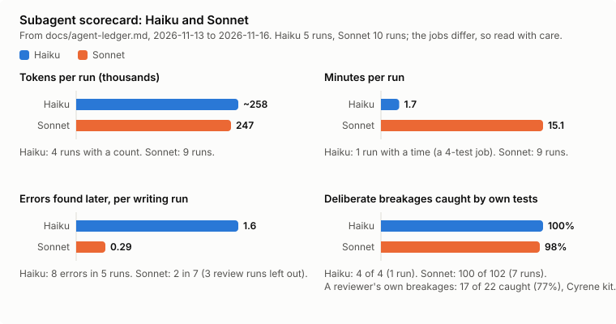

# Agent ledger

> **Why this file is public.** NouSR was built with AI coding agents under the maintainer's direction: the lead session runs
> on Claude Opus, subagents on Sonnet and Haiku, and a Fable model has also done review. This ledger records each
> subagent run (what it did, what it cost, what was found wrong with its work afterwards) so the project's use of agents can be
> checked and learned from rather than taken on trust. It is kept public for that reason, and as an example for contributors who
> work with agents. The rows are a record: they are not edited after the fact. See also [agent-briefs/](agent-briefs/README.md).

One row per subagent run, kept as we go, so a scorecard per model (Haiku, Sonnet, ...) can be charted at the end.
Requested by Smitty, 2026-11-16. Side sessions (separate Claude Code sessions on their own branches) are listed apart:
they run on the lead's model and do their own delegating.

Columns:
- **Tokens / tools / minutes:** from the harness's completion notice ("—" when it wasn't shown).
- **Found later:** errors in the agent's own work that a reviewer or the lead found afterwards. "Clean" means none found.
- **Mutations:** for writers, how many deliberate breakages its tests caught; for reviewers, how many they ran.

## Subagents

| Date | Model | Job | Tokens | Tools | Min | Found later | Mutations | Notes |
|---|---|---|---|---|---|---|---|---|
| 2026-11-13 | Haiku | Tribbie kit (pilot) | — | — | — | 6 modelling errors (deep review) | — | Passed its own tests. Led to "Sonnet for kits" (memory: subagent-models) |
| 2026-11-13/14 | Haiku ×3 | 15 relic-set modules | 266k–342k each | — | — | 1 medium, 1 low-medium error; 2 over-cautious refusals (Sonnet review) | — | Good at honest refusals; missed engine semantics |
| 2026-11-15 | Sonnet | Review: Castorice kit | 213k | 47 | 10.5 | Reviewer: 5 bugs found (B1–B5), no wrong numbers | ran 41, 31 caught | Found the rounded Cyrene rate, the healed-event leak |
| 2026-11-15 | Sonnet | Review: Hyacine kit | 210k | 31 | 10.3 | Reviewer: 6 items, no wrong numbers | ran 34, ~17 caught | Found missing Technique, Ultimate order question |
| 2026-11-15 | Sonnet | Hyacine review fixes + ~20 tests | — | — | — | Clean (lead verified) | 20 run, 18 killed, 2 equivalent | |
| 2026-11-15 | Sonnet | WRD + Amphoreus memosprite modules | 229k | 69 | 14.0 | Clean (lead read the logic) | 24 run, all killed | Flagged stale wording in 3 other modules |
| 2026-11-15 | Sonnet | Write: Cyrene kit + This Love, Forever | 413k | 33* | 15.2* | 1 reading arguably wrong (Ode to Ego; settled in game), 4 surviving mutants, Robin Ode gap | 22 run, all caught | *after resume; first run hit the usage limit |
| 2026-11-15 | Sonnet | Review: Cyrene kit + end-to-end run | 224k | 51 | 19.1 | Reviewer: standard-build bug (not the writer's file), Robin gap | ran 22, 17 caught | First full Castorice-team run |
| 2026-11-15 | Haiku | 4 missing Cyrene tests | 120k | 12 | 1.7 | Clean (lead verified) | 4 run, 4 killed | Tight brief, pattern work |
| 2026-11-15 | Sonnet | Apply in-game results (8 items) | 273k | 81 | 16.3 | Clean (lead verified suite) | 12 run, all killed | |
| 2026-11-15 | Sonnet | K31 technique toggles + K32 SPD at load | 257k | 82 | 22.1 | Clean; flagged its own change to an earlier decision (K14f) | ~14 run, all killed | |
| 2026-11-16 | Sonnet | Build `nousr run` CLI, results writer, packaging, CI | 266k | 86 | 21.0 | Clean so far (lead verified suite, build, real run); 1 schema field added and reported | 7 run, all caught | Fixed the stale example scenario; flagged 4 open choices |
| 2026-11-16 | Sonnet | CLI follow-ups: reaction damage, downed targets, spd_solved | 136k | 36 | 7.2 | Clean (lead verified suite, build, log sums = totals) | 3 run, all caught | 2 optional schema fields, reported |
| 2026-11-16 | Sonnet | MoC period module (step 7) | 122k | 39 | 7.0 | Clean (lead merged, suite passes) | 2 run, all caught | Linked its worktree to main's node_modules/vendor by NTFS junctions (cleanup needs care) |
| 2026-11-16 | Fable | Pre-release review: install test, 3-kit spot-check, publish safety, docs, scorecard | 219k | 66 | 9.5 | Reviewer: 1 kit discrepancy (Acheron own-Ultimate stack), personal data in git history, README order | — | Worked on main instead of the brief's commit, noticed and corrected it |
| 2026-11-16 | Sonnet | Draft rotations + 5 comparison scenarios (private) | 245k | 65 | 10.9 | Pending Smitty's approval of rotations; found 7 missing relic sets in the scan | — | Sourced KQM + Prydwen (via Tavily; Prydwen blocks direct fetch) |

## Side sessions

| Date | Job | Branch / commit | Outcome |
|---|---|---|---|
| 2026-11-15 | The Herta + Anaxa kits | `claude/practical-khayyam-2c2d55` / b132ce4 | Done; 1,768 tests reported passing (to verify on merge). Hit a usage limit once |
| 2026-11-15 | Sunday + Dan Heng PT standard builds | `claude/focused-albattani-bf53c3` / e057d91 | Done; lead verified 1,657 pass, 1 environment skip |
| 2026-11-15 | Results report + CLI draft | `claude/jolly-shannon-4661a4` / 59f10e5 | Draft for review (12 questions) |

## Scorecard per model (Computed from the tables above, 2026-11-16)

| Measure | Haiku | Sonnet |
|---|---|---|
| Runs | 5 (1 pilot kit, 3 relic-set runs, 1 test job) | 10 (7 writing, 3 review) |
| Tokens per run | about 258k (4 runs with a count: 3 at 266k to 342k, taken at 304k, and 120k) | 247k (2,221k over 9 runs with a count) |
| Minutes per run | 1.7 (1 run with a time) | 15.1 (135.7 over 9 runs with a time) |
| Errors found later in its own work | 8 in 5 writing runs (6 + 2), 1.6 per run; also 2 over-cautious refusals | 2 in 7 writing runs (both in the Cyrene kit), 0.29 per run |
| Deliberate breakages caught by its own tests | 4 of 4 (100%, 1 run) | 100 of 102 (98%, 7 runs; the 2 misses were equivalent mutants) |
| Breakages a separate reviewer ran against the work | not measured | 17 of 22 caught (77%) on the Cyrene kit |

How to read it: the two models did different jobs (Haiku: a pilot kit, pattern modules and a 4-test job; Sonnet: kits,
reviews, engine and CLI work), and Haiku has 5 runs, one of them timed. So this shows what happened; it is not a
like-for-like comparison. The Castorice and Hyacine reviews (31 of 41 and about 17 of 34 breakages caught) are left out
of the last row because the ledger does not say which model wrote those kits.
